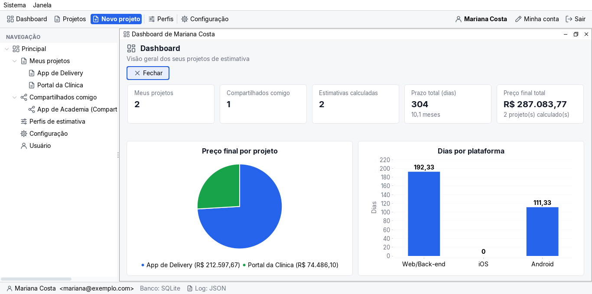
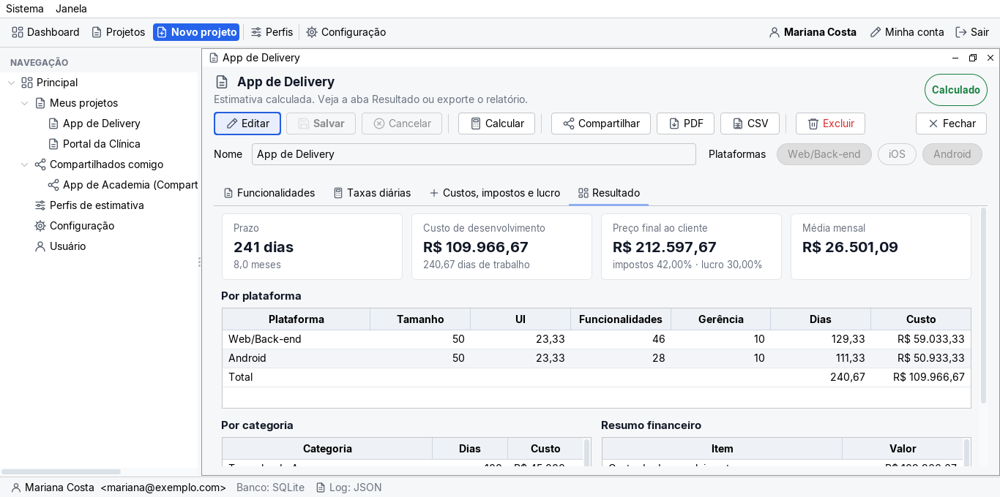
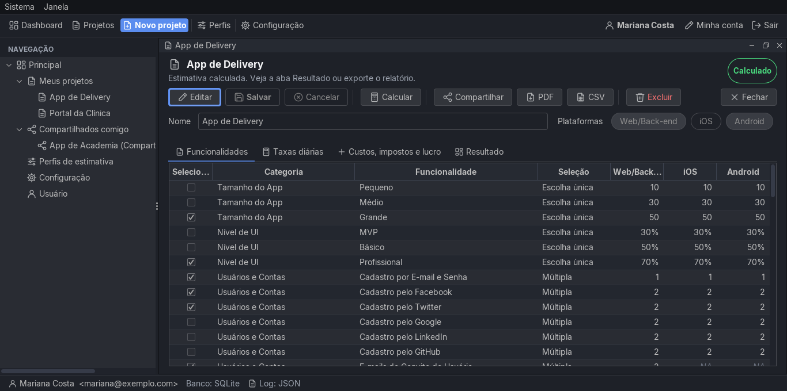
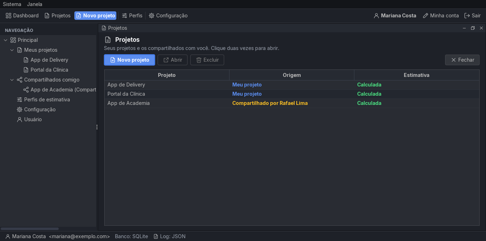

# Estimativa de Projeto de Software

Trabalho final da disciplina de Projeto de Sistemas de Software (UFES). A ideia é ajudar quem desenvolve apps a responder a pergunta clássica do cliente: *quanto custa e quanto tempo leva?*

Você escolhe as plataformas (Web/Back-end, iOS, Android), marca as funcionalidades que o app vai ter e o sistema calcula os dias de trabalho, o custo de desenvolvimento e o preço final, já com custos adicionais, impostos e lucro. Os valores de base vêm dos perfis do [EstimateMyApp](https://www.estimatemyapp.com/), e o cálculo segue a planilha que o professor passou (Tabela 1), inclusive no jeito de contar o nível de UI.



## O que dá para fazer

- Criar conta e entrar com e-mail e senha (a senha passa pelo validador do professor).
- Manter **perfis de estimativa**: a lista de funcionalidades com os dias de cada plataforma. O perfil padrão já vem carregado e não pode ser excluído; dá para copiar e montar o seu.
- Criar **projetos** a partir de um ou mais perfis. O projeto é uma cópia, então mexer nele não altera o perfil nem os outros projetos.
- Marcar plataformas e funcionalidades, ajustar taxas diárias, custos adicionais, impostos e lucro, e **calcular** a estimativa.
- **Compartilhar** um projeto com outro usuário, que só consegue visualizar.
- **Exportar** o relatório em PDF ou CSV.
- Acompanhar tudo no **dashboard**.
- Escolher o formato do **log** (CSV ou JSON) e o **tema** (claro ou escuro).

| Resultado da estimativa | Funcionalidades (tema escuro) |
|---|---|
|  |  |

| Projetos, com os compartilhados | Login |
|---|---|
|  |  |

## Como rodar

Precisa de **JDK 17+** e **Maven**. Não precisa instalar banco nenhum: SQLite e H2 rodam embutidos.

O log fica num projeto Maven separado, na pasta `estimativa-log/`. Enquanto ele não estiver publicado no JitPack, instale-o antes:

```bash
cd estimativa-log
mvn install
cd ..
```

Depois:

```bash
cp .env.example .env
mvn clean package
java -jar target/estimativa.jar
```

O `mvn clean package` roda os testes e gera o `target/estimativa.jar`, com tudo dentro. Rode o jar na mesma pasta do `.env`.

Na primeira vez o sistema cria o banco, o perfil padrão e um usuário de teste:

- e-mail: `kaua@email.com`
- senha: `A@#bb`

> Se você já rodou uma versão antiga e aparecer o aviso de que o banco "foi criado por uma versão antiga", apague (ou renomeie) a pasta `db/` e abra de novo.

### SQLite ou H2

A troca é só no `.env`:

```properties
# SQLite
TIPO_BANCO = "SQLite"
DB_URL = jdbc:sqlite:db/database.db

# H2
TIPO_BANCO = "H2"
DB_URL = jdbc:h2:./db/estimativa
```

### Atalhos

| Tecla | O que faz |
|---|---|
| Enter | confirma o login e os diálogos |
| Esc | fecha a janela ou cancela o diálogo |
| Ctrl+S | salva a tela que está em edição |
| Ctrl+N | novo projeto |

## Como o cálculo funciona

Para cada plataforma marcada:

- **tamanho do app**: dias base (pequeno, médio ou grande);
- **nível de UI**: dias base × (soma dos percentuais de UI das plataformas marcadas ÷ 3), como na planilha;
- **funcionalidades**: soma dos dias das funcionalidades marcadas que se aplicam àquela plataforma ("NA" não conta e não é a mesma coisa que zero);
- **gerente de projeto**, se marcado.

O custo multiplica os dias pela taxa de cada papel (desenvolvimento, design e gerência), que pode ser diferente em cada plataforma. Em cima disso entram os custos adicionais, os impostos e o lucro. Tudo é feito com `BigDecimal` e só é arredondado na hora de mostrar.

O caso da planilha (Web + Android, tamanho grande, UI profissional) é um dos testes automatizados: dá **240,67 dias**, **R$ 109.966,67** de desenvolvimento e **R$ 212.597,67** de preço final.

## Organização do código

O pacote base é `com.br.estimativadeprojetodesoftware`. A interface é Swing com MDI, no padrão MVP Passive View: a view só monta a tela e quem decide tudo é o presenter.

| Pasta | O que tem |
|---|---|
| `model` | perfil, projeto, funcionalidades, taxas, resultado |
| `service` | regras de negócio e cálculo |
| `repository`, `repository/jdbc` | acesso ao banco com JDBC puro (sem JPA/Hibernate) |
| `abstractfactory`, `strategy` | escolha do banco (SQLite ou H2) pelo `.env` |
| `presenter`, `state`, `command` | telas, estados de cada tela e ações |
| `view`, `view/componentes` | telas Swing e componentes reutilizáveis |
| `templatemethod`, `adapter` | exportação em PDF/CSV e adaptadores |
| `observer` | atualização entre janelas abertas |

Os padrões pedidos no trabalho estão lá: Repository, State com Command nos CRUDs, Observer entre janelas e Adapter no log e no validador de senhas. Também usamos Abstract Factory, Strategy, Template Method, Prototype e Singleton.

As especificações ficam em `openspec/specs/`. O que foi atendido de cada requisito, e onde está no código, está em [`docs/requisitos-implementados.md`](docs/requisitos-implementados.md).

## Testes

```bash
mvn test
```

São 70 testes, cobrindo o cálculo (com o caso da planilha), a persistência em SQLite e H2, os serviços, a exportação, o log e partes da interface.

## Equipe

- Gabriel Tetzner Menegueti
