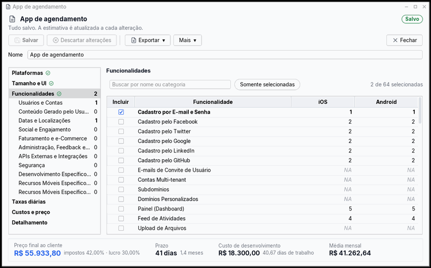
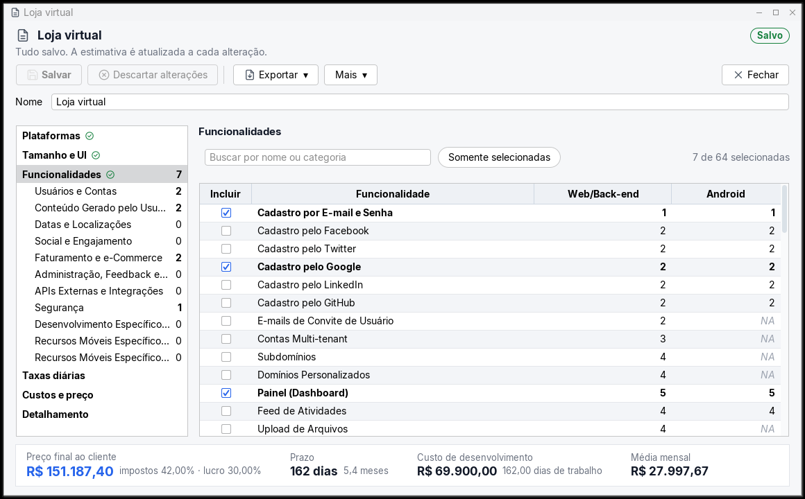
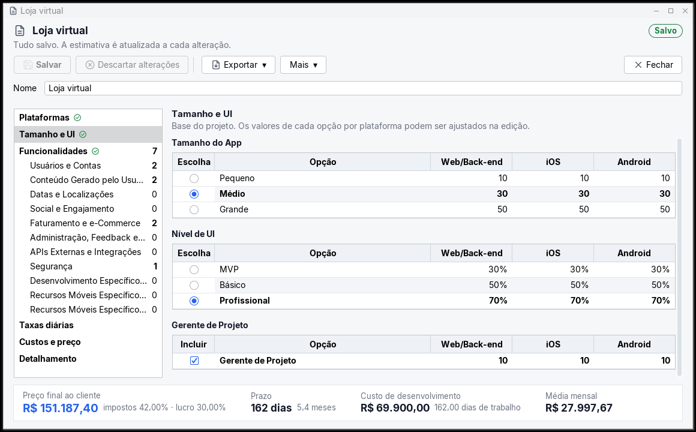
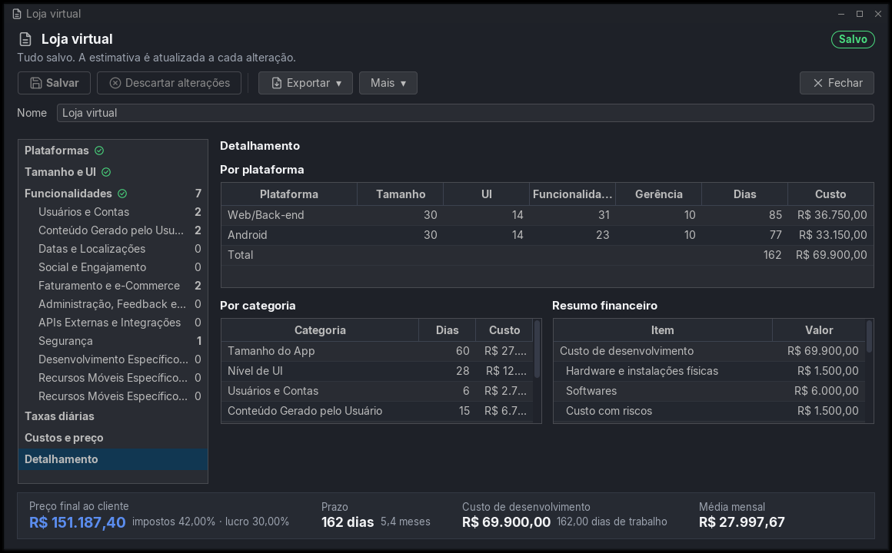
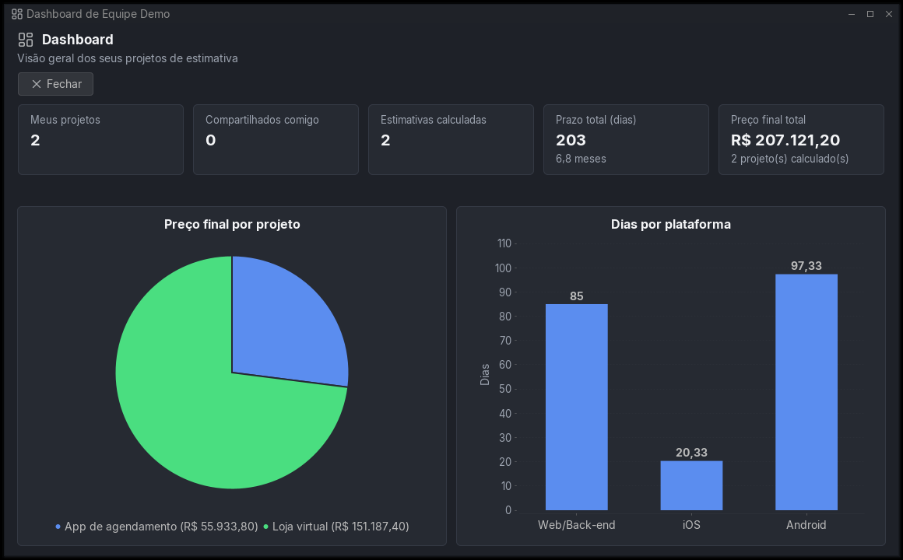
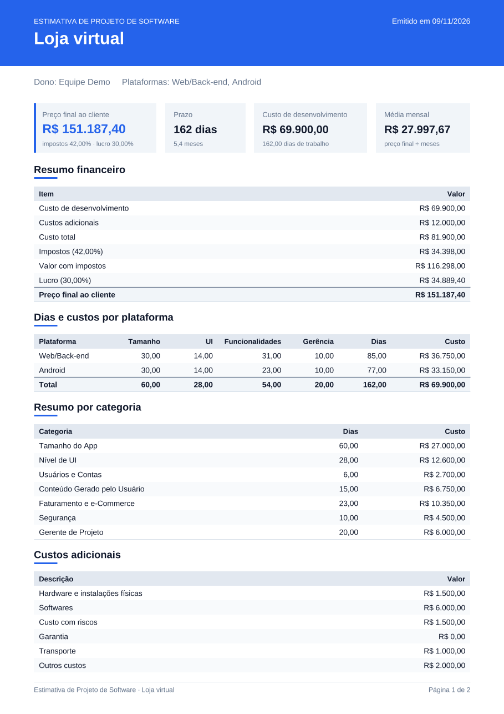
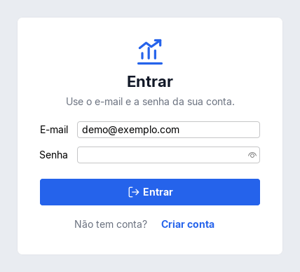

# Estimativa de Projeto de Software

Sistema desktop que responde a pergunta que todo cliente faz para quem desenvolve apps: **quanto custa e quanto tempo leva?** Você marca as plataformas e as funcionalidades do aplicativo, e o prazo, o custo e o preço final aparecem na hora, a cada alteração.



Trabalho final de Projeto de Sistemas de Software (UFES), feito em Java 25 com Swing, JDBC puro e os padrões de projeto pedidos na disciplina. Os valores de base vêm dos perfis do [EstimateMyApp](https://www.estimatemyapp.com/), e o cálculo segue a planilha do professor (Tabela 1).

## Destaques

- **Estimativa ao vivo:** cada marcação recalcula prazo, custo de desenvolvimento, preço final e média mensal em memória, em cerca de 10 ms. O banco só é gravado quando você clica em Salvar.
- **Tela que não trava:** todo acesso ao banco roda fora da thread da interface, numa fila de uma thread só, e Salvar grava em lotes. Contra o banco no Supabase, Salvar caiu de **5,9 s para 0,39 s** (de 152 para 12 idas ao banco).
- **Três bancos, o mesmo código:** SQLite, H2 ou PostgreSQL (Supabase), escolhidos no `.env`, com JDBC puro e sem framework de persistência.
- **Vários usuários no mesmo banco:** cada um tem seus projetos, seus perfis e o seu tema (claro ou escuro), que volta quando ele entra. Um projeto pode ser compartilhado com outro usuário, que só consulta.
- **Banco remoto protegido:** SSL com verificação do certificado, esquema fora da API pública do Supabase, RLS em todas as tabelas e um usuário de banco só para o sistema.
- **213 testes automatizados**, com 70% de cobertura de linhas medida pelo JaCoCo a cada build.
- **Teste final de usabilidade:** todas as telas foram percorridas no app de verdade, com mouse e teclado, em 1366×768 e 1024×600, nos dois temas. O que apareceu foi corrigido (veja [Usabilidade](#usabilidade)).

## Telas

| Funcionalidades | Tamanho e UI |
|---|---|
|  |  |

| Detalhamento (tema escuro) | Dashboard (tema escuro) |
|---|---|
|  |  |

| Relatório em PDF | Login |
|---|---|
|  |  |

## O que dá para fazer

- Criar conta e entrar com e-mail e senha (a senha passa pelo validador do professor).
- Manter **perfis de estimativa**: a lista de funcionalidades com os dias de cada plataforma. O perfil padrão já vem carregado e não pode ser excluído; dá para copiar e montar o seu.
- Criar **projetos** a partir de um ou mais perfis. O projeto é uma cópia, então mexer nele não altera o perfil nem os outros projetos. A lista de projetos mostra o prazo e o preço final de cada um, para comparar sem abrir.
- Montar a estimativa numa tela com uma seção por vez, escolhida numa barra lateral que marca o que já foi preenchido: **Plataformas**, **Tamanho e UI** (tamanho do app, nível de UI e gerente de projeto), **Funcionalidades** (por categoria, com busca e filtro "Somente selecionadas"), **Taxas diárias**, **Custos e preço** e **Detalhamento**. O resumo fica fixo no rodapé, com a variação causada pela última alteração.
- **Compartilhar** um projeto com outro usuário, que só consegue consultar.
- **Exportar** o relatório em PDF (com cabeçalho, resumo do preço e do prazo, tabelas e numeração de páginas) ou em CSV.
- Acompanhar tudo no **dashboard**.
- Escolher o **tema** (claro ou escuro), que é de cada usuário e volta quando ele entra, e o formato do **log** (CSV ou JSON), que vale para todos. As telas de entrada usam o último tema escolhido.

## Decisões técnicas

- **MVP Passive View:** as views só montam componentes; toda decisão fica nos presenters, que são testados sem abrir janela.
- **State com Command nos CRUDs:** a tela de projeto tem os estados Inclusão, Edição e Somente leitura, e cada ação é um Command. O dono abre o projeto já em edição, em vez de passar por uma tela de visualização e clicar em Editar como no diagrama visto em aula. Salvar e Descartar alterações só ficam habilitados quando há algo a salvar.
- **Recálculo sem persistência:** as alterações recalculam a estimativa em memória, com um atraso de 250 ms que junta digitações seguidas. Só Salvar grava, gera um único registro no log e avisa as outras janelas (Observer).
- **Fila única de banco:** o sistema usa uma só conexão JDBC, então as operações de banco rodam numa fila de uma thread (`FilaBanco`), e o resultado volta para a thread do Swing. Enquanto isso, a janela mostra o progresso e bloqueia os cliques, sem congelar.
- **Gravação em lote:** funcionalidades e valores de um projeto vão em dois lotes, então o número de idas ao banco não depende de quantas funcionalidades o perfil tem. Um teste garante o limite de 15 idas.
- **Preferências por usuário:** o tema fica na tabela `configuracao` com a chave `interface.tema.<id do usuário>`, sem mudar o esquema, e é lido junto com a autenticação para a janela principal já abrir com ele. A chave `interface.tema` guarda o último tema usado, que vale para as telas de entrada e para quem ainda não escolheu. O formato do log continua valendo para todos.
- **Bancos intercambiáveis:** Strategy (`DatabaseInitializer`) e Abstract Factory (`FabricaRepository`) escolhem o banco pelo `.env`, e o esquema usa só tipos aceitos pelos três.
- **Valores exatos:** dias e dinheiro em `BigDecimal`, arredondados só na exibição.

## Como rodar

### Baixar pronto

Baixe o `estimativa.jar` na [página de releases](https://github.com/Tetzdesen/EstimativaDeProjetoDeSoftware/releases/latest) e rode com o **Java 25** ou mais novo:

```bash
java -jar estimativa.jar
```

Sem `.env` ao lado, o sistema usa SQLite e guarda o banco e o log na pasta `.estimativa-de-projeto` dentro da sua pasta de usuário. Entre com o usuário de teste abaixo ou crie uma conta.

### Compilar

Precisa de **JDK 25+** e **Maven**. Não precisa instalar banco nenhum: SQLite e H2 rodam embutidos.

```bash
cp .env.example .env
mvn clean package
java -jar target/estimativa.jar
```

O `mvn clean package` baixa as dependências (o módulo de log vem do JitPack), roda os testes e gera o `target/estimativa.jar`, com tudo dentro. Rode o jar na mesma pasta do `.env`; sem ele, valem os padrões descritos em [Baixar pronto](#baixar-pronto).

Na primeira vez o sistema cria o banco, o perfil padrão e um usuário de teste:

- e-mail: `kaua@email.com`
- senha: `A@#bb`

> Se você já rodou uma versão antiga e aparecer o aviso de que o banco "foi criado por uma versão antiga", apague (ou renomeie) a pasta `db/` e abra de novo.

### No Windows

1. Instale o Java 25. Pelo PowerShell:

   ```powershell
   winget install EclipseAdoptium.Temurin.25.JDK
   ```

   (ou baixe o instalador em [adoptium.net](https://adoptium.net)).

2. Instale o Maven: baixe o zip em [maven.apache.org](https://maven.apache.org/download.cgi), extraia (por exemplo em `C:\maven`) e coloque `C:\maven\bin` no `Path` das variáveis de ambiente.

3. Feche e abra o terminal e confira se `java -version` e `mvn -version` respondem. Se o `mvn` reclamar do `JAVA_HOME`, crie essa variável apontando para a pasta do JDK (algo como `C:\Program Files\Eclipse Adoptium\jdk-25...`).

4. No PowerShell:

   ```powershell
   git clone https://github.com/Tetzdesen/EstimativaDeProjetoDeSoftware.git
   cd EstimativaDeProjetoDeSoftware
   copy .env.example .env
   mvn clean package
   java -jar target\estimativa.jar
   ```

O sistema lê o `.env` da pasta de onde é aberto. Se você der dois cliques no `estimativa.jar` dentro de `target\`, ele não acha o `.env` e usa os padrões (SQLite na pasta `.estimativa-de-projeto` do seu usuário), ou seja, outro banco. Para usar o banco do `.env`, rode pelo terminal a partir da pasta do projeto ou copie o `.env` para dentro de `target\`.

Também dá para abrir a pasta no NetBeans ou no IntelliJ, que já vêm com Maven: rode o `clean package` pela IDE e execute a classe `Principal` com a pasta do projeto como diretório de trabalho.

### SQLite, H2 ou PostgreSQL (Supabase)

A troca é só no `.env`:

```properties
# SQLite
TIPO_BANCO = "SQLite"
DB_URL = jdbc:sqlite:db/database.db

# H2
TIPO_BANCO = "H2"
DB_URL = jdbc:h2:./db/estimativa

# PostgreSQL no Supabase (pooler de sessão, SSL com verificação do certificado)
TIPO_BANCO = "Postgres"
DB_URL = jdbc:postgresql://<host do pooler de sessão>:5432/postgres?currentSchema=estimativa&sslmode=verify-full&sslrootcert=db/certs/prod-ca-2021.crt
DB_USER = estimativa_app.<referência-do-projeto>
DB_PASSWORD = <senha do papel estimativa_app>
```

O `.env` não vai para o git; nunca coloque senhas no `.env.example`.

#### Preparar um projeto no Supabase

1. Crie o projeto com a Data API desligada (o sistema só usa JDBC) e uma senha forte para o `postgres`.
2. Em *Database → Settings*, ligue *Enforce SSL on incoming connections* e baixe o certificado (*SSL Certificate*) para `db/certs/prod-ca-2021.crt`.
3. No *SQL Editor*, rode `docs/supabase/configurar.sql`, trocando `TROCAR_PELA_SENHA_DO_APP` por uma senha forte só no editor (não salve o arquivo com ela). O script cria o esquema `estimativa`, fora da API pública, e o papel `estimativa_app`, que só enxerga esse esquema.
4. Preencha o `.env` como acima; o host do pooler aparece no painel em *Connect → Session pooler*. Na primeira execução o sistema cria as tabelas (com RLS ativado) e roda os seeders.

A conexão é recusada se a `DB_URL` não tiver `sslmode=verify-full` e `sslrootcert`. Acrescentar `&reWriteBatchedInserts=true` à URL faz o driver juntar os `INSERT` de cada lote num só comando, o que deixa Salvar ainda mais rápido. Se a conexão cair depois de muito tempo parado, o sistema reabre na próxima operação.

#### Migrar os dados de um banco para outro

O `MigradorBanco` copia tudo (usuários, perfis, projetos, compartilhamentos e configuração) de um banco para outro vazio, numa única transação. Origem e destino são arquivos no formato do `.env`, para a senha não aparecer na linha de comando:

```bash
mvn clean package
java -cp target/estimativa.jar com.br.estimativadeprojetodesoftware.migracao.MigradorBanco origem.env destino.env
```

Ele recusa um destino que já tenha usuários ou perfis e, no fim, mostra a contagem de cada tabela na origem e no destino. Rode-o antes de abrir o sistema no destino, senão os seeders criam o administrador e o perfil padrão e o destino deixa de estar vazio.

#### Cuidados com o banco no Supabase

- Projetos gratuitos pausam depois de uma semana sem uso; reative pelo painel do Supabase se a conexão falhar.
- O administrador criado pelo seeder tem senha conhecida; num banco compartilhado, troque essa senha pelo sistema.
- Quem tiver IP fixo pode limitar o acesso em *Database → Network Restrictions*.

### Atalhos

| Tecla | O que faz |
|---|---|
| Enter | confirma o login e os diálogos; nas listas de projetos e perfis, abre o selecionado |
| Esc | fecha a janela ou cancela o diálogo; com um menu aberto, fecha só o menu; na busca de funcionalidades, limpa a busca |
| Ctrl+S | salva a tela que está em edição |
| Ctrl+N | novo projeto |

## Usabilidade

Antes da entrega, o sistema passou por um teste de ponta a ponta com as telas reais: criar conta, entrar, criar e editar um projeto, exportar, compartilhar, abrir como o outro usuário (somente leitura), perfis, configuração e tema escuro, em 1366×768 e 1024×600. Além de olhar cada tela, um roteiro conferiu texto cortado, contraste, botões só com ícone sem dica e campos sem rótulo. O que foi encontrado e corrigido:

| Problema | Correção |
|---|---|
| Esc com o menu "Exportar ▾" ou "Mais ▾" aberto fechava a janela do projeto | Esc fecha só o menu |
| Projeto novo com nome digitado era descartado sem aviso ao fechar | Pede confirmação antes de desistir |
| Depois de criar um projeto, abri-lo pela árvore abria uma segunda janela do mesmo projeto | A janela passa a ser a do projeto criado; não duplica |
| No Detalhamento, valores em reais cortados ("R$ 12.15...") e tabelas baixas | Colunas de valor com largura mínima e tabelas ocupando a altura da janela |
| Tabela de funcionalidades escondia a coluna Android em janelas estreitas | Rola na horizontal quando as colunas não cabem |
| Perfil mostrava valores internos ("UNICA", "MULTIPLA", "PERCENTUAL") | Mostra "Única", "Múltipla", "Percentual" |
| "Excluir" ativo no perfil padrão, que não pode ser excluído | Botão desabilitado, com a explicação na dica |
| Mensagens de senha sem acento e com ";" ("Senha nao deve possuir uma sequencia...") | O Adapter do validador corrige a escrita |
| "Exportar ▾" e "Mais ▾" ativos num projeto ainda não salvo | Ficam ativos só quando alguma ação do menu está disponível |
| Busca sem resultado deixava a tabela vazia sem explicação | Aviso com o termo buscado, botão de limpar e Esc para limpar |
| Enter não abria o projeto ou perfil selecionado na lista | Enter abre, como o duplo clique |
| Depois de errar a senha, o foco sumia | O foco volta para a senha, com o texto selecionado |
| Esc não fechava as janelas de login e cadastro | Fecha (no cadastro, o mesmo que Cancelar) |
| Configuração dizia "as mudanças valem na hora", mas era preciso clicar em Salvar | Texto corrigido |
| "Compartilhar com o selecionado" ativo sem ninguém selecionado | Só ativa depois de escolher o usuário |
| "Minha conta" sem botão de fechar e com o resumo em campos que pareciam editáveis | Botão Fechar e resumo sem borda de campo |
| Lista de projetos sem prazo e preço | Colunas "Prazo (dias)" e "Preço final" |
| O tema era um só para todos: quem escolhia o escuro trocava o tema de todo mundo | Cada usuário tem o seu tema, aplicado no login |
| Em 1024×600, o indicador "Média mensal" ficava escondido no rodapé | Numa janela estreita, o detalhe de cada indicador desce para baixo do valor e os quatro cabem |

## Como o cálculo funciona

Para cada plataforma marcada:

- **tamanho do app**: dias base (pequeno, médio ou grande);
- **nível de UI**: dias base × (soma dos percentuais de UI das plataformas marcadas ÷ 3), como na planilha;
- **funcionalidades**: soma dos dias das funcionalidades marcadas que se aplicam àquela plataforma ("NA" não conta e não é a mesma coisa que zero);
- **gerente de projeto**, se marcado.

O custo multiplica os dias pela taxa de cada papel (desenvolvimento, design e gerência), que pode ser diferente em cada plataforma. Em cima disso entram os custos adicionais, os impostos e o lucro. Tudo é feito com `BigDecimal` e só é arredondado na hora de mostrar.

O caso da planilha (Web + Android, tamanho grande, UI profissional) é um dos testes automatizados: dá **240,67 dias**, **R$ 109.966,67** de desenvolvimento e **R$ 212.597,67** de preço final.

## Organização do código

O pacote base é `com.br.estimativadeprojetodesoftware`. A interface é Swing com MDI, no padrão MVP Passive View: a view só monta a tela e quem decide tudo é o presenter.

| Pasta | O que tem |
|---|---|
| `model` | perfil, projeto, funcionalidades, taxas, resultado |
| `service` | regras de negócio e cálculo |
| `repository`, `repository/jdbc` | acesso ao banco com JDBC puro (sem JPA/Hibernate) |
| `abstractfactory`, `strategy` | escolha do banco (SQLite, H2 ou PostgreSQL) pelo `.env` |
| `presenter`, `state`, `command` | telas, estados de cada tela e ações; `presenter/helpers/FilaBanco` tira o banco da thread do Swing |
| `migracao` | cópia de todos os dados de um banco para outro |
| `view`, `view/componentes` | telas Swing e componentes reutilizáveis |
| `templatemethod`, `adapter` | exportação em PDF/CSV e adaptadores |
| `observer` | atualização entre janelas abertas |

O log é um projeto Maven à parte, publicado em [Tetzdesen/estimativa-log](https://github.com/Tetzdesen/estimativa-log) e incluído pelo JitPack. A pasta `estimativa-log/` deste repositório tem o mesmo código.

Os padrões pedidos no trabalho estão lá: Repository, State com Command nos CRUDs, Observer entre janelas e Adapter no log e no validador de senhas. Também usamos Abstract Factory, Strategy, Template Method, Prototype e Singleton.

O que foi atendido de cada requisito, e onde está no código, está em [`docs/requisitos-implementados.md`](docs/requisitos-implementados.md).

## Testes

```bash
mvn verify
```

São 213 testes: o cálculo (com o caso da planilha), a persistência em SQLite e H2, a gravação em lote, a migração entre bancos, a fila de banco, a exportação, o log e os presenters de todas as telas, inclusive login, cadastro, perfis, configuração e dashboard. Os testes rodam numa pasta sem `.env`, então nunca acessam o banco configurado.

O `mvn verify` também gera o relatório de cobertura em `target/site/jacoco/index.html` e falha se a cobertura de linhas ficar abaixo de 65%. Hoje ela está em 70%.

### Imagens do README

As capturas e o GIF são gerados com as telas reais e dados de demonstração num H2 em memória:

```bash
mvn -q test-compile dependency:build-classpath -Dmdep.outputFile=target/cp.txt
java -cp "target/classes:target/test-classes:$(cat target/cp.txt)" \
  com.br.estimativadeprojetodesoftware.presenter.projeto.GeradorVitrine docs/imagens target/vitrine/quadros
python3 scripts/montar-gif.py target/vitrine/quadros docs/imagens/recalculo-ao-vivo.gif
```

## Autoria

Desenvolvido por **Gabriel Tetzner Menegueti**.

O projeto começou como trabalho em grupo da disciplina de Projeto de Sistemas de Software (UFES). Depois eu assumi o projeto sozinho e o finalizei: reestruturei a arquitetura (MVP Passive View, State com Command), implementei a estimativa recalculada ao vivo, o suporte a SQLite, H2 e PostgreSQL/Supabase, a fila de banco fora da thread da interface, a interface, os relatórios em PDF e CSV e os testes. Hoje cerca de 98% do código é meu.

Agradeço a Kauã Souza, Flávio Monteiro e Hiago Lopes, que participaram da primeira versão; as contribuições deles estão no histórico de commits.

## Licença

[MIT](LICENSE).
